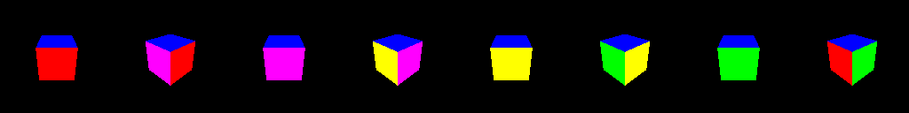
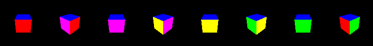
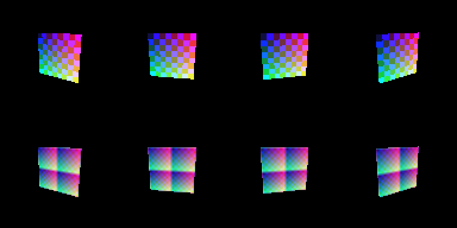
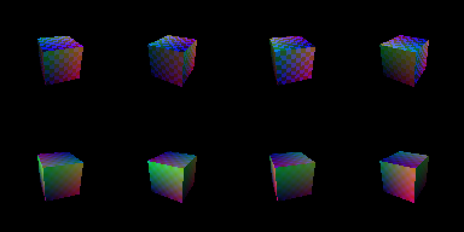

# AnythingPS5 by AK

**PNR - PlayStation Native Runtime.** A research prototype that explores
running native x86-64 game binaries through a compatibility layer: a loader,
a PlayStation-style system-call shim, a package and library system, a
headless launcher, and an offscreen Vulkan graphics path. Written in C++,
licensed GPL-2.0.

> **Honest status.** PNR cannot run any commercial PS5 game. No Sony
> firmware, SDK code, keys or game files are used, and no DRM is bypassed.
> Everything below runs on Linux x86-64, headless, with developer-built demo
> programs. There is **no GUI yet** and no window or display output. The file
> "jail" is application-level path routing, **not a security sandbox**. **Optional Linux sandbox: `launch --sandbox` (partial isolation, with a private pivot_root filesystem since slice B2b; see docs/sandbox.md).**

**Contents:**
[What it does](#what-it-does) -
[Rendered output](#rendered-output) -
[How it works](#how-it-works) -
[Architecture](#architecture) -
[Quick start](#quick-start) -
[Capability table](#what-works-right-now-phase-0--phase-1-prototype) -
[Captured sessions](#example-output) -
[Roadmap](#roadmap) -
[Security honesty](#security-honesty-what-the-jail-is-and-is-not)

## What it does

| Area | Today (all headless) |
|---|---|
| Run native programs | Validates an ELF64 binary, classifies every import, and runs it as a supervised child process with its own file jail |
| PlayStation-style calls | A shim library exports real `sceKernel*` functions (memory, threads, timing, jailed file I/O). Unimplemented calls are reported, never faked |
| Packages | `.pnrgame` archives (tar plus SHA-256 manifest), built by `pnr_make_package`, verified and installed by a controlled importer |
| Library | SQLite store of games, installs, launches and compatibility state |
| Launcher core | `pnr-launcher`: list, show, launch, history, set compatibility, scan, import, remove, verify, doctor, clean, save export and restore |
| Graphics | Offscreen Vulkan rendering on software Vulkan (lavapipe): triangle, spinning triangle, cube, lit, textured and lit-textured meshes, game-supplied meshes. Hand-authored SPIR-V, plus a restricted RDNA-to-SPIR-V translation path (experimental) |
| PSN purchases | Unofficial NPSSO connector: local token store, saved-response import, owned-on-PSN rows kept separate from installed games, manual linking to compatibility, and a live `psn sync` (libcurl loaded at runtime, TLS verified, Sony hosts only). **Live Sony behaviour is Untested; no download feature** |
| Performance | Rule-based adaptive performance engine and laptop power-mode caps |

Not done: verification of live PSN sync against real Sony (Untested), game downloads (no authorized mechanism found), real PS5 binaries, Sony APIs, a window or swapchain, hardware GPU
testing, audio output, a desktop launcher UI, untrusted-code isolation.
No benchmarks exist; none are claimed.

Test state: **2227/2227 unit tests, 17/17 CTest suites** on a fresh Linux
Release `-Werror` build (details in the capability section below).

## Rendered output

These images are frame strips produced by the demo programs on the
**software Vulkan driver (Mesa lavapipe)** in a headless Linux sandbox. They
were converted from the demos' PPM frame files to PNG during development.
Nothing here is hardware GPU output, and nothing is a Sony API: the `pnrGfx*`
functions are PNR's own extension. Re-run the demos (see Quick start) to
reproduce them.

**Triangle** - first offscreen draw, hand-authored SPIR-V shaders.


**Spinning triangle** - 8 frames, per-frame rotation pushed to the vertex shader.


**Cube** - indexed mesh with a depth buffer, checked against a CPU ray caster.



**Game-driven cube** - `ps_cube_demo` runs its own frame loop under `pnr run` and presents frames into its jail.


**RDNA-translated vertex stage** - the MVP transform is generated as restricted RDNA machine code and translated to SPIR-V compute (experimental).


**Game-driven RDNA cube** - the same path driven from a game program.



**Game-supplied pyramid** - `ps_mesh_demo` uploads its own 5-vertex mesh.


**Lit cube** - per-vertex normals with a directional light (Lambert diffuse).


**Textured** - RGBA8 texture sampled by a hand-authored fragment shader.



**Lit and textured** - texture, tint and light combined.



Terminal output from the CLI and launcher is shown as captured text in
[Captured sessions](#example-output), which is easier to copy and search than
screenshots.

## How it works

```
 .pnrgame package            pnr-launcher / pnr CLI
 (tar + SHA-256) --import--> library (SQLite) --run--> validate ELF
                                                         |
                          classify imports (host / PRX / PNR ext / unknown)
                                                         |
                    supervised child process, LD_LIBRARY_PATH -> PS-ABI shim
                                                         |
          sceKernel* calls -> jailed files, memory, threads, timers
          pnrGfx* calls   -> offscreen Vulkan (lavapipe) -> frame files
                                                         |
                    exit status -> launch history -> compatibility state
```

1. **Package and import.** A package carries a manifest with SHA-256 sums.
   The importer verifies checksums, checks the ELF, rejects path traversal
   and registers the game.
2. **Launch.** The loader parses and validates the ELF and classifies each
   import. The binary runs natively in a separate process; the shim library
   serves the PlayStation-style calls it makes.
3. **Jail.** File calls resolve inside `jail/<game id>`. This is path routing
   in the shim, not OS enforcement.
4. **Graphics.** Games call `pnrGfx*` to upload meshes, textures and lights
   and to present frames. The renderer draws offscreen with Vulkan and writes
   frames into the jail.
5. **Compatibility honesty.** A clean exit moves Untested to Launches Only.
   Only a person can set Playable states, and nothing claims playability.

## Architecture

Modules (see [docs/architecture.md](docs/architecture.md) and
[docs/interface-contracts.md](docs/interface-contracts.md)):
core runtime, loader and PRX layer, compat services, host OS abstraction,
adaptive performance engine, laptop manager, game services, library,
package/importer, headless launcher core, graphics. Planned: security
manager (Module 11), desktop UI.

## Quick start

```sh
cmake -S . -B build -DCMAKE_BUILD_TYPE=RelWithDebInfo
cmake --build build -j
ctest --test-dir build --output-on-failure
cd build
./pnr run ./ps_demo          # PS-style demo through the shim
./pnr run ./ps_cube_demo     # game-driven cube frames
./pnr_make_package demo.pnrgame demo-game "PNR Demo" 0.1.0 bin/game bin/game=./ps_demo
./pnr-launcher import demo.pnrgame
./pnr-launcher list
./pnr-launcher doctor
```

Full command reference with real captured output is in
[Captured sessions](#example-output). Linux x86-64 only; a Windows build
compiles but cannot run ELF games.

## What works right now (Phase 0 + Phase 1 prototype)

| Capability | Status |
|---|---|
| Core runtime: lifecycle state machine, event bus, config, capability registry, error reporting | Implemented, Tested |
| ELF64 binary parser + validator (bounds-checked, specific errors) | Implemented, Tested |
| Native loader: validated binaries executed in a supervised separate process | Implemented (Linux), Tested |
| PS NID computation + symbol lookup (SHA-1 based; algorithm adapted from [AnyPS5](https://github.com/boykopovar/AnyPS5), GPL-2.0) | Implemented, Tested |
| PRX system-library layer: libkernel (usleep/sleep/alloc/free/thread/mmap/mprotect/munmap/query; jailed file calls open/read/write/close/lseek/fstat) + libSceLibcInternal (printf-bounded/malloc/free/memcpy/memset/strlen/strcmp) bound by NID; taxonomy per AnyPS5, original implementations | Implemented, Tested |
| Loader import resolution: ELF dynamic imports classified host / prx-implemented / prx-declared / unknown at launch; unimplemented never faked | Implemented, Tested |
| PS-ABI shim + PS-style demo: `libpnr_psabi.so` exports real sce functions (alloc/free, usleep, thread, mmap family, jailed file I/O); `ps_demo` imports only sce* + libc and `pnr run` dispatches every sce import for real | Implemented, Tested |
| Compat services: memory, timing, jailed filesystem, threads | Implemented, Tested |
| Host OS abstraction (IF-OS): Linux backend (CPU/memory/power/process launch) | Implemented (Linux), Tested |
| `.pnrgame` package format: ustar + SHA-256 manifests, builder | Implemented, Tested |
| Controlled importer: checksum verification, ELF validation, traversal protection, library registration | Implemented, Tested |
| Game library metadata: SQLite store (games, installations, compatibility, launches) | Implemented, Tested |
| Library run by game id: `pnr run <id>` resolves the installed package, gives the game its own jail, records the launch, and honestly advances compatibility Untested to Launches Only on a clean exit | Implemented, Tested |
| CLI driving the full 10-step launch workflow with honest per-step results | Implemented, Tested |
| Developer-controlled demo app running only on compat services | Implemented, Tested |
| Vulkan compute backend: dlopen-loaded (no SDK needed), instance/device/SSBO/pipeline/dispatch/readback; absence of a driver is reported, never faked | Implemented (compute), Tested on software Vulkan (Mesa lavapipe) in the sandbox; hardware GPU untested |
| Offscreen graphics slice: image + render pass + framebuffer + graphics pipeline, hand-authored SPIR-V vertex/fragment shaders (`graphics/demo/`), draw, copy-to-host; pixel-verified (center, corners, analytic coverage 1152/4096, orientation, determinism). **No swapchain, no window, no display**. Also an animated slice: interleaved vertex buffer + per-frame vertex push constants render an 8-frame spinning RGB triangle sequence; per-frame centroid, coverage and vertex colors verified against the analytic rotation | Implemented, Tested on software Vulkan (lavapipe) via shim and official headers; hardware GPU untested. Frames are rendered and read back sequentially (no frame pacing, no presentation). Also a 3D slice: indexed unit-cube mesh, D32 depth buffer, column-major MVP pushed per frame (`graphics/mat4.hpp`), 8-frame rotating cube checked pixel-by-pixel against an independent CPU ray caster (0 mismatches of 9216 per frame) and depth ON vs OFF shown to differ. Headless offscreen only: flat face colors, no lighting or textures, hand-authored SPIR-V (not translated from RDNA), no swapchain/display; PNR_CUBE_PPM writes a frame strip |
| Game-driven rendering: `ps_cube_demo` runs under `pnr run`, its frame loop calls `pnrGfx*` (PNR extension, not Sony API) in `libpnr_psabi.so`, including `pnrGfxDrawCubeRdna` which renders through the translated-RDNA compute-as-vertex path and is checked byte-for-byte against the hand-authored reference in the game; frames presented as PPM into the game's jail and read back by the game; CLI step 5 reports the offscreen renderer, step 8 counts frame files | Implemented, Tested on software Vulkan (byte-identical to harness render); headless, no swapchain/display; hardware GPU untested |
| Game-supplied mesh: `pnrGfxSetMesh` (validated, bounded, copied) + `pnrGfxDrawMesh(yaw,pitch,mode)` (hand-authored VS or translated-RDNA path); `ps_mesh_demo` uploads its own pyramid under `pnr run`, refuses 9 invalid uploads, presents 8 spinning frames | Implemented, Tested on software Vulkan: unit tests match the presented silhouette to a CPU projection (0 mismatched pixels per frame), RDNA vs hand-authored frames 0 differing bytes (1 byte off by one in the ASan build, so the game tolerates +-2). PNR extension, not a Sony API; max 24 vertices (RDNA kernel lanes), flat vertex colours interpolated, no textures/lighting, headless, hardware GPU untested |
| Per-vertex normals + directional light: `pnrGfxSetLitMesh` / `pnrGfxSetLight` / `pnrGfxDrawLitMesh`, Lambert diffuse with ambient 0.25, computed per vertex by a hand-authored shader (reference) or by translated RDNA kernels (MVP transform + dot3); `ps_lit_demo` runs under `pnr run` with a mid-run light change | Implemented, Tested on software Vulkan: presented pixels match an independent CPU Lambert shading (0 mismatched of 9216 per frame, 8 frames), dot3 kernel equals the CPU float dot (max diff 0), RDNA vs hand-authored frames 0 differing bytes (game tolerates +-3 on 1%). Gouraud (per-vertex) only, one directional light, no specular/textures/shadows; max 24 vertices; max() clamp is in the hand-authored fragment shader; PNR extension, not a Sony API; hardware GPU untested |
| Texture: `pnrGfxSetTexture` (RGBA8, 1..256 per side, nearest/linear, repeat/clamp) / `pnrGfxSetTexturedMesh` / `pnrGfxDrawTexturedMesh`; a hand-authored fragment shader samples it (`ps_tex_demo` under `pnr run`) | Implemented, Tested on software Vulkan (llvmpipe): presented pixels match an independent CPU ray-cast + nearest/bilinear sampler (0-1 mismatched of 9216 per frame, 8 frames, nearest +-0, linear +-4). Limits: no mipmaps, no anisotropy, 8-bit RGBA only, hand-authored vertex stage only (no RDNA path), sampler behaviour is the host driver's, no swapchain/display, hardware GPU untested |
| Lit + textured mesh: `pnrGfxSetLitTexturedMesh` / `pnrGfxDrawLitTexturedMesh` (11 floats per vertex: xyz, rgb tint, uv, normal) with `pnrGfxSetTexture` and `pnrGfxSetLight`; `rgb = texel * tint * (0.25 + 0.75 * max(d,0))`; `ps_lit_demo`-style cube in `ps_littex_demo` under `pnr run` | Implemented, Tested on software Vulkan (llvmpipe): presented pixels match an independent CPU ray-cast + Lambert + tint + nearest/bilinear texture (0 mismatched of 9216 per frame, 8 frames). Limits: hand-authored vertex and fragment shaders only (no RDNA path for this combination), flat per-face normals in the demo, no mipmaps, 8-bit RGBA, host driver sampler, no swapchain/display, hardware GPU untested |
| RDNA-translated vertex stage (compute-as-vertex): `graphics/rdna_vertex.hpp` generates restricted RDNA machine code (v_mul_f32/v_add_f32 with MVP scalars in s0..s15, flat load/store over a 24-lane SSBO), the PNR translator turns it into SPIR-V compute, four dispatches give clip x,y,z,w for the cube's 24 vertices, and those positions are drawn through a pass-through vertex shader (`render_clip_mesh_rgba`, float4 clip + colour). 8 rotating frames compared with the hand-authored MVP vertex shader | Experimental, Tested on software Vulkan: clip positions match a CPU float reference (max diff 0) and 0 of 73728 pixels differ from the hand-authored frames on lavapipe. Not a real RDNA vertex-stage ABI (no VS inputs/exports/parameter cache), only the float ops the translator supports, instruction encodings written by PNR rather than compiled from a game shader, no exact PS5 float rounding guarantee, hardware GPU untested; pixel equality on another driver is not promised |
| SPIR-V emission: compute write-back module shape, word-level emitter | Implemented (subset), Tested (spirv-val + real dispatch); full shader stages Planned |
| RDNA shader decoder: all encoding families detected, field extraction for scalar+vector families, named mnemonic subset (scalar/vector partial), literals/64-bit words/truncation handled honestly; taxonomy adapted from [AnyPS5](https://github.com/boykopovar/AnyPS5) (GPL-2.0) | Implemented (subset), Tested (synthetic words); SDWA/DPP + image/memory payload fields Planned |
| RDNA bytes to SPIR-V: v_mov, flat_load_dword, uint32 add/sub/and/or/xor, one flat_store_dword + s_endpgm; SSA runtime data, explicit 1..64-invocation workgroup/bounded SSBO ABI (v0=local index in multi-invocation mode, disjoint affine outputs), static offsets plus runtime low-address bounds/alignment guards (invalid load=0/store=skip), checked host buffer length | Experimental, Tested (synthetic bytes, spirv-val, lavapipe readback for constant and runtime inputs); no commercial shaders or wave semantics; full64 pointers limited to one invocation |
| Restricted conditional selection: scalar equality + one forward SCC0 skip over move-only body, branch/Phi merge; workgroup-uniform decisions select lane-varying data (readfirstlane only in single mode) | Experimental, Tested (2/8/64 invocations, both outcomes, spirv-val, lavapipe); no combined loop/selection, nested branches, conditional memory effects, divergent SCC or wave reduction |
| Scalar/uniform inputs: initial s0..s15 from explicit runtime push constants, scalar copies, vector ALU broadcast and uniform-driven workgroup selection | Experimental, Tested (changed uniforms on same SPIR-V, Vulkan shim + official headers, lavapipe); not a Sony user-data ABI |
| Float32 VOP2 add/sub/mul: raw-bit registers, real SPIR-V arithmetic, NoContraction | Experimental host-Vulkan FP policy, Tested on lavapipe; exact PS5 rounding/denormal/NaN payload behavior not implemented |
| Full64 runtime pointers: scalar add/addc/sub/subb pair arithmetic, carry-aware FLAT offsets, lexicographic bounds/alignment guards | Experimental, Tested (cross-low-word bindings, overflow/borrow/OOB, spirv-val + lavapipe); single invocation, existing bounded SSBO only |
| Strict counted loop: scalar constant or runtime uniform count 1..64, one uint32 vector accumulator add, decrement/compare/backedge; real SPIR-V LoopMerge/Phi | Experimental, Tested (1/2/8/64 invocations, 1/2/16/64 counts, spirv-val + lavapipe); invalid runtime count rejected before dispatch plus GPU no-op guard; no body memory, nesting or general CFG |
| Proof-checked copy loop: guarded dword load/store, two affine pointer increments, constant/runtime uniform count; exact lane x iteration collision/alias proof | Experimental, Tested (spirv-val + lavapipe, tiled/transposed maps, offsets, invalid-count no-op); no in-place updates, full64 loop pointers or broader body/control flow |
| Adaptive Performance Engine (deterministic rules, hardware class heuristic, closed-loop controller) | Implemented, Tested |
| Laptop Optimization Manager (battery/balanced/max-performance caps) | Implemented, Tested |
| Game services: virtual filesystem (jailed areas, per-game/user save isolation) | Implemented, Tested |
| Game services: input (evdev enumeration, mapping profiles, virtual device) | Implemented, Tested |
| Game services: audio (interface + honest null backend) | Interface Implemented, host backends Planned |
| Windows backend | Implemented (hwinfo via Win32; ELF launch Blocked, cross-compile CI-verified) |
| Rust components | Planned (no Rust toolchain in current sandbox) |
| Any commercial PS5 software support | Blocked (proprietary formats, authorization, DRM — see docs) |

Latest measured test result on Linux x86-64 (g++ 11.4, CMake 3.22):
**2227/2227 unit tests pass, 17/17 CTest suites pass** (unit, end-to-end native
launch, full package workflow: build -> import -> list -> run imported
game, the cube/mesh/lit/texture/lit-texture `pnr run` demos, plus the headless launcher journeys, compact
shader fixtures/mutation diagnostics) on a fresh Release `-Werror` build
and on a build against the official Vulkan headers. ASan+UBSan: 2227/2227
unit tests pass with leak detection disabled (no leak-check claim); under
ASan, `pnr_psgame_workflow` still fails on one known exact-count assertion
(a documented sanitizer artifact, not fixed). No benchmarks exist yet; none
are claimed.

## Build (Linux)

```sh
cmake -S . -B build -DCMAKE_BUILD_TYPE=RelWithDebInfo
cmake --build build -j
ctest --test-dir build --output-on-failure
```

## Run the demo

```sh
cd build
./pnr run ./pnr_test_app     # validate + natively execute the demo app
./pnr validate ./pnr_test_app
./pnr hwinfo

# package workflow
./pnr_make_package demo.pnrgame demo-game "PNR Demo Game" 0.1.0 bin/game bin/game=./pnr_test_app
./pnr import demo.pnrgame    # verifies checksums + ELF, installs, registers
./pnr games                  # library listing from SQLite
./pnr run ./pnr_data/games/demo-game-0.1.0/bin/game
```


## Example output

Captured verbatim from a real session on this repo's Linux build (the
dev sandbox has no GPU or audio device, and that is exactly what the
output says - nothing is faked):

```text
=== $ pnr assess ===
PNR hardware assessment (heuristic, honest bounds):
hardware.class=A (budget / ultra low-end) (CPU/RAM only; GPU unknown in this build)
power.default_mode=balanced (battery state unknown: balanced)
caps.fps_cap=60 caps.min_resolution_scale=75% caps.max_background_tasks=2
note: compatibility is never decided from class alone - real frame telemetry drives the adaptive controller

=== $ pnr hwinfo ===
PNR hardware snapshot (host truth, no estimates):
host.platform=linux
cpu.logical_cores=2
mem.total_mb=1982
mem.available_mb=1706
power.on_battery=unknown (no power_supply node on this host)
gpu[0].name=llvmpipe (LLVM 15.0.7, 256 bits) vendor=0x10005 api=1.3.255 type=software (CPU Vulkan)

=== $ pnr gpu ===
PNR GPU snapshot (real Vulkan enumeration):
gpu[0].name=llvmpipe (LLVM 15.0.7, 256 bits) vendor=0x10005 api=1.3.255 type=software (CPU Vulkan)

=== $ pnr input ===
input.backend=evdev
input.devices=0
  (no input devices visible on this host)

=== $ pnr audio ===
audio.backend=null
audio.devices=0
  (no audio devices available; host audio backends Planned)

=== $ pnr games (empty library) ===
library is empty (import a .pnrgame first)

=== $ pnr import demo.pnrgame ===
IMPORT OK: PNR Test App 1.0.0 (x86-64)
  id=pnr-test-app
  installed=./pnr_data/games/pnr-test-app-1.0.0
  compatibility=Untested (no execution test yet)

=== $ pnr games ===
PNR Test App  v1.0.0  [Untested]
    ./pnr_data/games/pnr-test-app-1.0.0

=== $ pnr run pnr-test-app ===
pnr_test_app: native x86-64 demo starting
pnr_test_app: args=0
pnr_test_app: memory ok (4096 bytes outstanding)
pnr_test_app: thread result=100000
pnr_test_app: sleep(5ms) measured 5.067ms
pnr_test_app: save-data write+readback ok
pnr_test_app: memory released (0 outstanding)
pnr_test_app: ALL OK - exiting 0
[1-validate] SUCCESS   ./pnr_data/games/pnr-test-app-1.0.0/bin/game is a valid x86-64 ELF (13 segments)
[1-imports] SUCCESS   70 imports: 67 host-resolved, 3 prx-implemented, 0 prx-declared-only, 0 unknown
  [import] strlen                           prx-implemented
  [import] memcpy                           prx-implemented
  [import] free                             prx-implemented
[2-analysis] SUCCESS   logical cores=2; gpu=llvmpipe (LLVM 15.0.7, 256 bits) (software Vulkan)
[3-config] SUCCESS   default profile 'balanced' (no game profile found; defaults used openly)
  [event] lifecycle -> VALIDATING
  [event] lifecycle -> INITIALIZING
  [event] lifecycle -> READY
[4-runtime] SUCCESS   compat memory/fs/thread services up
[5-graphics] SKIPPED   game imports no pnrGfx* calls (non-graphical); the offscreen renderer is available to games that do (see ps_cube_demo)
[6-content] SUCCESS   save-data dir jailed at ./pnr_data/saves
--- game output begin ---
  [event] lifecycle -> RUNNING
  [monitor] wall=0.007s exit=0
--- game output end ---
[7-start] SUCCESS   game ran natively in child process, exit code 0
[8-monitor] SUCCESS   wall time + exit status measured (non-graphical game: no frame-time telemetry)
[9-optimize] SKIPPED   deterministic adaptive controller is Phase 4 work
  [event] lifecycle -> STOPPING
  [event] lifecycle -> TERMINATED
[10-shutdown] SUCCESS   resources released, 0 errors recorded
RESULT: RUN OK (real native execution)
[library] launch recorded; compatibility=Launches Only (exit 0, gameplay unverified)
```

Note: this sandbox has the SQLite runtime but no dev headers, so the repo
carries a minimal API shim (`library/sqlite3_shim.h`). On a normal dev
machine define `PNR_USE_SYSTEM_SQLITE3` and use the system header.

`pnr run` prints the master workflow's ten steps with explicit
SUCCESS / FAILED / BLOCKED / SKIPPED markers — a BLOCKED graphics step is
reported, never hidden.

### `pnr run ./ps_demo` - the PS-style showcase

`ps_demo` imports only `sceKernel*` (plus plain libc) symbols. The CLI
points the dynamic loader at the PS-ABI shim (`LD_LIBRARY_PATH`), sets `PNR_JAIL_ROOT`, classifies
the binary's imports, and runs it natively. Captured verbatim:

```text
ps_demo: heap alloc/fill/free ok
ps_demo: map/protect/unmap ok
ps_demo: jailed file write/stat/seek/read ok
ps_demo: usleep measured 20071us
ps_demo: thread ran
ps_demo: ALL SCE CALLS DISPATCHED OK
[1-validate] SUCCESS   ./ps_demo is a valid x86-64 ELF (13 segments)
[1-imports] SUCCESS   22 imports: 8 host-resolved, 14 prx-implemented, 0 prx-declared-only, 0 unknown
  [import] sceKernelMTypeprotect            prx-implemented
  [import] sceKernelMapMemory               prx-implemented
  [import] sceKernelMunmap                  prx-implemented
  [import] sceKernelCreateThread            prx-implemented
  [import] sceKernelWrite                   prx-implemented
  [import] sceKernelOpen                    prx-implemented
  [import] sceKernelFstat                   prx-implemented
  [import] sceKernelLseek                   prx-implemented
  [import] sceKernelFree                    prx-implemented
  [import] strcmp                           prx-implemented
  [import] sceKernelUsleep                  prx-implemented
  [import] sceKernelClose                   prx-implemented
  [import] sceKernelRead                    prx-implemented
  [import] sceKernelAlloc                   prx-implemented
[2-analysis] SUCCESS   logical cores=2; gpu=llvmpipe (LLVM 15.0.7, 256 bits) (software Vulkan)
[3-config] SUCCESS   default profile 'balanced' (no game profile found; defaults used openly)
  [event] lifecycle -> VALIDATING
  [event] lifecycle -> INITIALIZING
  [event] lifecycle -> READY
[4-runtime] SUCCESS   compat memory/fs/thread services up
[5-graphics] SKIPPED   game imports no pnrGfx* calls (non-graphical); the offscreen renderer is available to games that do (see ps_cube_demo)
[6-content] SUCCESS   save-data dir jailed at ./pnr_data/saves
--- game output begin ---
  [event] lifecycle -> RUNNING
  [monitor] wall=0.023s exit=0
--- game output end ---
[7-start] SUCCESS   game ran natively in child process, exit code 0
[8-monitor] SUCCESS   wall time + exit status measured (non-graphical game: no frame-time telemetry)
[9-optimize] SKIPPED   deterministic adaptive controller is Phase 4 work
  [event] lifecycle -> STOPPING
  [event] lifecycle -> TERMINATED
[10-shutdown] SUCCESS   resources released, 0 errors recorded
RESULT: RUN OK (real native execution)
```

Every `sceKernel*` import classifies **prx-implemented** and the calls do
real work through the shim: heap via `malloc`, anonymous memory via
`mmap`/`mprotect`, files through the jailed file service (the proof file
lands inside `./pnr_data/jail`), and a real measured sleep + thread.

### `pnr run ./ps_cube_demo` - a game drives a rotating 3D cube

`ps_cube_demo` is a developer-built native program. Its own frame loop
advances a rotation, calls the PNR shim's `pnrGfx*` extension (PNR calls,
**not** Sony APIs), presents each frame as a PPM file inside its jail, then
reads the files back with `sceKernel*` file calls to verify them. The
renderer is offscreen Vulkan (software lavapipe here): **no swapchain, no
window, no display**. `pnr run` classifies the `pnrGfx*` imports as
`pnr-extension`, reports the graphics step honestly, and counts the frame
files at monitor time. The presented frames go through the translated-RDNA
vertex path (`pnrGfxDrawCubeRdna`: RDNA-style compute kernel, 4 dispatches,
clip-space positions into the draw path) and the game checks each PPM is
byte-identical to a hand-authored-vertex-shader reference it also renders
(`frame_ms` below covers both draws). This is compute-as-vertex-stage on a PNR
test ABI, not a real RDNA vertex stage. Captured verbatim:

```text
ps_cube_demo: offscreen renderer up (96x96, RDNA-translated vertex stage, no swapchain/display)
ps_cube_demo: frame 0 yaw=0.000 covered=1220 frame_ms=12.7
ps_cube_demo: frame 1 yaw=0.785 covered=1334 frame_ms=4.9
ps_cube_demo: frame 2 yaw=1.571 covered=1220 frame_ms=4.9
ps_cube_demo: frame 3 yaw=2.356 covered=1334 frame_ms=5.0
ps_cube_demo: frame 4 yaw=3.142 covered=1220 frame_ms=5.0
ps_cube_demo: frame 5 yaw=3.927 covered=1334 frame_ms=4.8
ps_cube_demo: frame 6 yaw=4.712 covered=1220 frame_ms=4.8
ps_cube_demo: frame 7 yaw=5.498 covered=1334 frame_ms=4.7
ps_cube_demo: 8 frames, avg 5.8 ms, worst 12.7 ms (software Vulkan)
ps_cube_demo: 8 RDNA-vertex frames byte-identical to hand-authored reference
ps_cube_demo: ALL FRAMES RENDERED, PRESENTED TO JAIL AND VERIFIED
[1-validate] SUCCESS   ./ps_cube_demo is a valid x86-64 ELF (13 segments)
[1-imports] SUCCESS   30 imports: 17 host-resolved, 6 prx-implemented, 0 prx-declared-only, 0 unknown, 7 pnr-extension
  [import] pnrGfxPresentToFile              pnr-extension
  [import] pnrGfxInit                       pnr-extension
  [import] memset                           prx-implemented
  [import] pnrGfxLastError                  pnr-extension
  [import] pnrGfxFramesRendered             pnr-extension
  [import] sceKernelOpen                    prx-implemented
  [import] sceKernelFstat                   prx-implemented
  [import] pnrGfxDrawCube                   pnr-extension
  [import] sceKernelUsleep                  prx-implemented
  [import] sceKernelClose                   prx-implemented
  [import] pnrGfxDrawCubeRdna               pnr-extension
  [import] sceKernelRead                    prx-implemented
  [import] pnrGfxRdnaFramesRendered         pnr-extension
[2-analysis] SUCCESS   logical cores=2; gpu=llvmpipe (LLVM 15.0.7, 256 bits) (software Vulkan)
[3-config] SUCCESS   default profile 'balanced' (no game profile found; defaults used openly)
  [event] lifecycle -> VALIDATING
  [event] lifecycle -> INITIALIZING
  [event] lifecycle -> READY
[4-runtime] SUCCESS   compat memory/fs/thread services up
[5-graphics] SUCCESS   game imports 7 pnrGfx* calls; the shim renders OFFSCREEN (headless) in the game process; gpu=llvmpipe (LLVM 15.0.7, 256 bits) (software Vulkan); no swapchain, no display
[6-content] SUCCESS   save-data dir jailed at ./pnr_data/saves
--- game output begin ---
  [event] lifecycle -> RUNNING
  [monitor] wall=0.205s exit=0
--- game output end ---
[7-start] SUCCESS   game ran natively in child process, exit code 0
[8-monitor] SUCCESS   wall time + exit status measured; 8 presented frame file(s), 221288 bytes in the jail (/frames); per-frame times are printed by the game, the runtime has no frame-time telemetry yet
[9-optimize] SKIPPED   deterministic adaptive controller is Phase 4 work
  [event] lifecycle -> STOPPING
  [event] lifecycle -> TERMINATED
[10-shutdown] SUCCESS   resources released, 0 errors recorded
RESULT: RUN OK (real native execution)
```

### `pnr run ./ps_mesh_demo` - a game uploads its own mesh

`ps_mesh_demo` supplies its own vertices and indices (a 5-vertex pyramid)
through `pnrGfxSetMesh` (PNR extension, **not** a Sony API; bounded to 1..24
vertices, 3..384 indices, finite floats, indices in range, data copied). It
first proves 9 invalid uploads are refused and that a failed upload leaves no
mesh behind, then spins the mesh with `pnrGfxDrawMesh`, once per frame with
the hand-authored vertex shader (reference) and once through the translated-
RDNA compute-as-vertex path, presents both into its jail, and compares them
(tolerance +-2 on 0.5% of bytes; fused vs unfused float rounding). The unit
tests also check the presented silhouette against an independent CPU
projection of the uploaded triangles. Offscreen only, no swapchain/display.
Captured verbatim:

```text
ps_mesh_demo: uploaded 5-vertex 6-triangle pyramid; 9 invalid uploads refused
ps_mesh_demo: frame 0 yaw=0.000 covered=588 (reference 588)
ps_mesh_demo: frame 1 yaw=0.785 covered=706 (reference 706)
ps_mesh_demo: frame 2 yaw=1.571 covered=588 (reference 588)
ps_mesh_demo: frame 3 yaw=2.356 covered=706 (reference 706)
ps_mesh_demo: frame 4 yaw=3.142 covered=588 (reference 588)
ps_mesh_demo: frame 5 yaw=3.927 covered=706 (reference 706)
ps_mesh_demo: frame 6 yaw=4.712 covered=588 (reference 588)
ps_mesh_demo: frame 7 yaw=5.498 covered=706 (reference 706)
ps_mesh_demo: 8 frames of the game's own mesh, RDNA path vs reference: 0 differing bytes (tolerance +-2 on 0.5%)
ps_mesh_demo: ALL FRAMES RENDERED, PRESENTED TO JAIL AND VERIFIED
[1-validate] SUCCESS   ./ps_mesh_demo is a valid x86-64 ELF (13 segments)
[1-imports] SUCCESS   27 imports: 16 host-resolved, 5 prx-implemented, 0 prx-declared-only, 0 unknown, 6 pnr-extension
  [import] pnrGfxMeshDraws                  pnr-extension
  [import] pnrGfxDrawMesh                   pnr-extension
  [import] pnrGfxPresentToFile              pnr-extension
  [import] pnrGfxInit                       pnr-extension
  [import] pnrGfxSetMesh                    pnr-extension
  [import] memset                           prx-implemented
  [import] pnrGfxLastError                  pnr-extension
  [import] sceKernelOpen                    prx-implemented
  [import] sceKernelFstat                   prx-implemented
  [import] sceKernelClose                   prx-implemented
  [import] sceKernelRead                    prx-implemented
[2-analysis] SUCCESS   logical cores=2; gpu=llvmpipe (LLVM 15.0.7, 256 bits) (software Vulkan)
[3-config] SUCCESS   default profile 'balanced' (no game profile found; defaults used openly)
  [event] lifecycle -> VALIDATING
  [event] lifecycle -> INITIALIZING
  [event] lifecycle -> READY
[4-runtime] SUCCESS   compat memory/fs/thread services up
[5-graphics] SUCCESS   game imports 6 pnrGfx* calls; the shim renders OFFSCREEN (headless) in the game process; gpu=llvmpipe (LLVM 15.0.7, 256 bits) (software Vulkan); no swapchain, no display
[6-content] SUCCESS   save-data dir jailed at ./pnr_data/saves
--- game output begin ---
  [event] lifecycle -> RUNNING
  [monitor] wall=0.072s exit=0
--- game output end ---
[7-start] SUCCESS   game ran natively in child process, exit code 0
[8-monitor] SUCCESS   wall time + exit status measured; 16 presented frame file(s), 442576 bytes in the jail (/frames); per-frame times are printed by the game, the runtime has no frame-time telemetry yet
[9-optimize] SKIPPED   deterministic adaptive controller is Phase 4 work
  [event] lifecycle -> STOPPING
  [event] lifecycle -> TERMINATED
[10-shutdown] SUCCESS   resources released, 0 errors recorded
RESULT: RUN OK (real native execution)
```

### `pnr run ./ps_tex_demo` - texture sampling

`ps_tex_demo` builds an 8x8 RGBA texture and a uv quad and uploads them with
`pnrGfxSetTexture` (flags: 1 = linear, 2 = repeat; sizes 1..256) and
`pnrGfxSetTexturedMesh` (8 floats per vertex: xyz, rgb tint, uv). A
hand-authored fragment shader outputs `texel.rgb * tint`. Frames 0..3 use
nearest + clamp with uv 0..1, frames 4..7 linear + repeat with uv 0..2. The
unit tests compare presented pixels with a CPU ray-cast and a CPU
nearest/bilinear sampler. Limits: one mip level, 8-bit RGBA, host Vulkan
sampler (llvmpipe here), no swapchain/display. Captured verbatim:

```text
ps_tex_demo: 8x8 texture + uv quad ready; 9 invalid calls refused
ps_tex_demo: frame 0 nearest/clamp yaw=-0.50 covered=1302
ps_tex_demo: frame 1 nearest/clamp yaw=-0.15 covered=1444
ps_tex_demo: frame 2 nearest/clamp yaw=0.20 covered=1430
ps_tex_demo: frame 3 nearest/clamp yaw=0.55 covered=1269
ps_tex_demo: frame 4 linear/repeat yaw=-0.50 covered=1302
ps_tex_demo: frame 5 linear/repeat yaw=-0.15 covered=1444
ps_tex_demo: frame 6 linear/repeat yaw=0.20 covered=1430
ps_tex_demo: frame 7 linear/repeat yaw=0.55 covered=1269
ps_tex_demo: ALL FRAMES RENDERED AND PRESENTED TO JAIL
[1-validate] SUCCESS   ./ps_tex_demo is a valid x86-64 ELF (13 segments)
[1-imports] SUCCESS   23 imports: 16 host-resolved, 0 prx-implemented, 0 prx-declared-only, 0 unknown, 7 pnr-extension
  [import] pnrGfxSetTexture                 pnr-extension
  [import] pnrGfxPresentToFile              pnr-extension
  [import] pnrGfxInit                       pnr-extension
  [import] pnrGfxLastError                  pnr-extension
  [import] pnrGfxDrawTexturedMesh           pnr-extension
  [import] pnrGfxSetTexturedMesh            pnr-extension
  [import] pnrGfxTexturedDraws              pnr-extension
[2-analysis] SUCCESS   logical cores=2; gpu=llvmpipe (LLVM 15.0.7, 256 bits) (software Vulkan)
[3-config] SUCCESS   default profile 'balanced' (no game profile found; defaults used openly)
  [event] lifecycle -> VALIDATING
  [event] lifecycle -> INITIALIZING
  [event] lifecycle -> READY
[4-runtime] SUCCESS   compat memory/fs/thread services up
[5-graphics] SUCCESS   game imports 7 pnrGfx* calls; the shim renders OFFSCREEN (headless) in the game process; gpu=llvmpipe (LLVM 15.0.7, 256 bits) (software Vulkan); no swapchain, no display
[6-content] SUCCESS   save-data dir jailed at ./pnr_data/saves
--- game output begin ---
  [event] lifecycle -> RUNNING
  [monitor] wall=0.061s exit=0
--- game output end ---
[7-start] SUCCESS   game ran natively in child process, exit code 0
[8-monitor] SUCCESS   wall time + exit status measured; 8 presented frame file(s), 221288 bytes in the jail (/frames); per-frame times are printed by the game, the runtime has no frame-time telemetry yet
[9-optimize] SKIPPED   deterministic adaptive controller is Phase 4 work
  [event] lifecycle -> STOPPING
  [event] lifecycle -> TERMINATED
[10-shutdown] SUCCESS   resources released, 0 errors recorded
RESULT: RUN OK (real native execution)
```

### `pnr run ./ps_littex_demo` - lit and textured together

`ps_littex_demo` uploads a 24-vertex cube with `pnrGfxSetLitTexturedMesh` (11
floats per vertex: position, rgb tint, uv, unit normal), an 8x8 texture with
`pnrGfxSetTexture` and a light with `pnrGfxSetLight`. A hand-authored vertex
shader computes the Lambert dot per vertex, a hand-authored fragment shader
outputs `texel.rgb * tint * (0.25 + 0.75 * max(d, 0))`. Frames 0..3 use nearest
filtering, frames 4..7 linear filtering and a new light direction. The unit
tests compare the presented pixels with an independent CPU ray-cast, Lambert
shading and texture sampler. Offscreen only, software Vulkan. Captured verbatim:

```text
ps_littex_demo: 24-vertex lit textured cube uploaded; 6 invalid calls refused
ps_littex_demo: frame 0 nearest yaw=0.300 covered=1239
ps_littex_demo: frame 1 nearest yaw=1.085 covered=1299
ps_littex_demo: frame 2 nearest yaw=1.871 covered=1239
ps_littex_demo: frame 3 nearest yaw=2.656 covered=1299
ps_littex_demo: frame 4 linear yaw=3.442 covered=1239
ps_littex_demo: frame 5 linear yaw=4.227 covered=1299
ps_littex_demo: frame 6 linear yaw=5.012 covered=1239
ps_littex_demo: frame 7 linear yaw=5.798 covered=1299
ps_littex_demo: ALL FRAMES RENDERED AND PRESENTED TO JAIL
[1-validate] SUCCESS   ./ps_littex_demo is a valid x86-64 ELF (13 segments)
[1-imports] SUCCESS   25 imports: 16 host-resolved, 1 prx-implemented, 0 prx-declared-only, 0 unknown, 8 pnr-extension
  [import] pnrGfxSetTexture                 pnr-extension
  [import] pnrGfxPresentToFile              pnr-extension
  [import] pnrGfxSetLitTexturedMesh         pnr-extension
  [import] pnrGfxInit                       pnr-extension
  [import] pnrGfxSetLight                   pnr-extension
  [import] pnrGfxLastError                  pnr-extension
  [import] memcpy                           prx-implemented
  [import] pnrGfxLitTexturedDraws           pnr-extension
  [import] pnrGfxDrawLitTexturedMesh        pnr-extension
[2-analysis] SUCCESS   logical cores=2; gpu=llvmpipe (LLVM 15.0.7, 256 bits) (software Vulkan)
[3-config] SUCCESS   default profile 'balanced' (no game profile found; defaults used openly)
  [event] lifecycle -> VALIDATING
  [event] lifecycle -> INITIALIZING
  [event] lifecycle -> READY
[4-runtime] SUCCESS   compat memory/fs/thread services up
[5-graphics] SUCCESS   game imports 8 pnrGfx* calls; the shim renders OFFSCREEN (headless) in the game process; gpu=llvmpipe (LLVM 15.0.7, 256 bits) (software Vulkan); no swapchain, no display
[6-content] SUCCESS   save-data dir jailed at ./pnr_data/saves
--- game output begin ---
  [event] lifecycle -> RUNNING
  [monitor] wall=0.072s exit=0
--- game output end ---
[7-start] SUCCESS   game ran natively in child process, exit code 0
[8-monitor] SUCCESS   wall time + exit status measured; 8 presented frame file(s), 221288 bytes in the jail (/frames); per-frame times are printed by the game, the runtime has no frame-time telemetry yet
[9-optimize] SKIPPED   deterministic adaptive controller is Phase 4 work
  [event] lifecycle -> STOPPING
  [event] lifecycle -> TERMINATED
[10-shutdown] SUCCESS   resources released, 0 errors recorded
RESULT: RUN OK (real native execution)
```

### `pnr run ./ps_lit_demo` - per-vertex normals and a directional light

`ps_lit_demo` builds its own 24-vertex cube with per-vertex face normals and
uploads it with `pnrGfxSetLitMesh` (9 floats per vertex; normals must be unit
length within 1%, never silently renormalised). `pnrGfxSetLight` sets a
view-space light direction (the demo changes it half way). Lambert diffuse:
`rgb = colour * (0.25 + 0.75 * max(d, 0))`, `d = dot(N, L)` per vertex and
interpolated. Each frame is drawn with a hand-authored lit vertex shader and
with the translated-RDNA path (transform kernel x4 plus a dot3 kernel for `d`);
`max()` is outside the translated subset, so a hand-authored fragment shader
does the clamp and ambient. The unit tests compare the presented pixels with an
independent CPU ray-cast and Lambert shading. Float rounding of the two vertex
paths agrees within a small tolerance, not bit-for-bit by contract. Offscreen
only, no swapchain/display. Captured verbatim:

```text
ps_lit_demo: uploaded 24-vertex lit cube with face normals; 8 invalid calls refused
ps_lit_demo: frame 0 yaw=0.300 covered=1239 (reference 1239)
ps_lit_demo: frame 1 yaw=1.085 covered=1299 (reference 1299)
ps_lit_demo: frame 2 yaw=1.871 covered=1239 (reference 1239)
ps_lit_demo: frame 3 yaw=2.656 covered=1299 (reference 1299)
ps_lit_demo: frame 4 yaw=3.442 covered=1239 (reference 1239)
ps_lit_demo: frame 5 yaw=4.227 covered=1299 (reference 1299)
ps_lit_demo: frame 6 yaw=5.012 covered=1239 (reference 1239)
ps_lit_demo: frame 7 yaw=5.798 covered=1299 (reference 1299)
ps_lit_demo: 8 lit frames, RDNA path vs reference: 0 differing bytes (tolerance +-3 on 1%)
ps_lit_demo: ALL FRAMES RENDERED, PRESENTED TO JAIL AND VERIFIED
[1-validate] SUCCESS   ./ps_lit_demo is a valid x86-64 ELF (13 segments)
[1-imports] SUCCESS   30 imports: 17 host-resolved, 6 prx-implemented, 0 prx-declared-only, 0 unknown, 7 pnr-extension
  [import] pnrGfxLitDraws                   pnr-extension
  [import] pnrGfxPresentToFile              pnr-extension
  [import] pnrGfxInit                       pnr-extension
  [import] memset                           prx-implemented
  [import] pnrGfxSetLight                   pnr-extension
  [import] pnrGfxLastError                  pnr-extension
  [import] memcpy                           prx-implemented
  [import] sceKernelOpen                    prx-implemented
  [import] sceKernelFstat                   prx-implemented
  [import] pnrGfxDrawLitMesh                pnr-extension
  [import] pnrGfxSetLitMesh                 pnr-extension
  [import] sceKernelClose                   prx-implemented
  [import] sceKernelRead                    prx-implemented
[2-analysis] SUCCESS   logical cores=2; gpu=llvmpipe (LLVM 15.0.7, 256 bits) (software Vulkan)
[3-config] SUCCESS   default profile 'balanced' (no game profile found; defaults used openly)
  [event] lifecycle -> VALIDATING
  [event] lifecycle -> INITIALIZING
  [event] lifecycle -> READY
[4-runtime] SUCCESS   compat memory/fs/thread services up
[5-graphics] SUCCESS   game imports 7 pnrGfx* calls; the shim renders OFFSCREEN (headless) in the game process; gpu=llvmpipe (LLVM 15.0.7, 256 bits) (software Vulkan); no swapchain, no display
[6-content] SUCCESS   save-data dir jailed at ./pnr_data/saves
--- game output begin ---
  [event] lifecycle -> RUNNING
  [monitor] wall=0.084s exit=0
--- game output end ---
[7-start] SUCCESS   game ran natively in child process, exit code 0
[8-monitor] SUCCESS   wall time + exit status measured; 24 presented frame file(s), 663864 bytes in the jail (/frames); per-frame times are printed by the game, the runtime has no frame-time telemetry yet
[9-optimize] SKIPPED   deterministic adaptive controller is Phase 4 work
  [event] lifecycle -> STOPPING
  [event] lifecycle -> TERMINATED
[10-shutdown] SUCCESS   resources released, 0 errors recorded
RESULT: RUN OK (real native execution)
```

Verified by tests: the PPM files the game wrote are byte-identical to a
harness render of the same matrices, and every pixel of the rotation
matches an independent CPU ray caster. Frame times are measured by the game
itself; the runtime has no frame-time telemetry yet. Per-frame pipeline
creation makes this a correctness demo, not a performance one.

### The full game journey, by id

A sce-only binary packages, imports, and runs by its library id - the same
journey a real game would take. Captured verbatim:

```text
=== $ pnr_make_package psdemo.pnrgame ps-demo "PNR PS Demo" 0.1.0 bin/game bin/game=./ps_demo ===
built psdemo.pnrgame (id=ps-demo version=0.1.0)

=== $ pnr import psdemo.pnrgame ===
IMPORT OK: PNR PS Demo 0.1.0 (x86-64)
  id=ps-demo
  installed=./pnr_data/games/ps-demo-0.1.0
  compatibility=Untested (no execution test yet)

=== $ pnr run ps-demo ===
ps_demo: heap alloc/fill/free ok
ps_demo: map/protect/unmap ok
ps_demo: jailed file write/stat/seek/read ok
ps_demo: usleep measured 20074us
ps_demo: thread ran
ps_demo: ALL SCE CALLS DISPATCHED OK
[1-validate] SUCCESS   ./pnr_data/games/ps-demo-0.1.0/bin/game is a valid x86-64 ELF (13 segments)
[1-imports] SUCCESS   22 imports: 8 host-resolved, 14 prx-implemented, 0 prx-declared-only, 0 unknown
  [import] sceKernelMTypeprotect            prx-implemented
  [import] sceKernelMapMemory               prx-implemented
  [import] sceKernelMunmap                  prx-implemented
  [import] sceKernelCreateThread            prx-implemented
  [import] sceKernelWrite                   prx-implemented
  [import] sceKernelOpen                    prx-implemented
  [import] sceKernelFstat                   prx-implemented
  [import] sceKernelLseek                   prx-implemented
  [import] sceKernelFree                    prx-implemented
  [import] strcmp                           prx-implemented
  [import] sceKernelUsleep                  prx-implemented
  [import] sceKernelClose                   prx-implemented
  [import] sceKernelRead                    prx-implemented
  [import] sceKernelAlloc                   prx-implemented
[2-analysis] SUCCESS   logical cores=2; gpu=llvmpipe (LLVM 15.0.7, 256 bits) (software Vulkan)
[3-config] SUCCESS   default profile 'balanced' (no game profile found; defaults used openly)
  [event] lifecycle -> VALIDATING
  [event] lifecycle -> INITIALIZING
  [event] lifecycle -> READY
[4-runtime] SUCCESS   compat memory/fs/thread services up
[5-graphics] SKIPPED   game imports no pnrGfx* calls (non-graphical); the offscreen renderer is available to games that do (see ps_cube_demo)
[6-content] SUCCESS   save-data dir jailed at ./pnr_data/saves
--- game output begin ---
  [event] lifecycle -> RUNNING
  [monitor] wall=0.023s exit=0
--- game output end ---
[7-start] SUCCESS   game ran natively in child process, exit code 0
[8-monitor] SUCCESS   wall time + exit status measured (non-graphical game: no frame-time telemetry)
[9-optimize] SKIPPED   deterministic adaptive controller is Phase 4 work
  [event] lifecycle -> STOPPING
  [event] lifecycle -> TERMINATED
[10-shutdown] SUCCESS   resources released, 0 errors recorded
RESULT: RUN OK (real native execution)
[library] launch recorded; compatibility=Launches Only (exit 0, gameplay unverified)

=== $ pnr games ===
PNR PS Demo  v0.1.0  [Launches Only]
    ./pnr_data/games/ps-demo-0.1.0
PNR Test App  v1.0.0  [Launches Only]
    ./pnr_data/games/pnr-test-app-1.0.0
```

The run needs no path: `pnr run ps-demo` resolves the installed package
from the library, routes the game's sce file calls into
`./pnr_data/jail/ps-demo`, and records the launch. Compatibility moves `Untested -> Launches Only` on a clean
exit - "it started and finished" and nothing more; playability is never
claimed. The sce shim itself is provided by the runtime (like firmware
modules), not shipped inside the package.

## Launcher core (headless, not a desktop UI)

Status: **Implemented, Tested** (unit tests plus the `pnr_launcher_workflow`
CTest). **There is no GUI**: no window, no artwork, no toolkit. The desktop
launcher UI (module 10) is still **Planned**. This slice is the logic a UI
would sit on, with a text/JSON front end.

- `launcher/launcher_core.*`: lists library games, shows details and
  compatibility status, launches by exact game id, records launch history.
- `apps/launcher/launcher_main.cpp` builds `pnr-launcher`:
  `list [--json]`, `show <id> [--json]`, `launch <id> [--json] [-- args]`.
- Library path: `PNR_LIBRARY_DB`, default `./pnr_data/library.db`.
- A clean exit (0) moves compatibility Untested -> Launches Only and nothing
  else. It never overwrites a state a human set. No playability is claimed.
- Each game gets its own jail folder next to the library, like `pnr run`.
- Limits: trusted developer-built content only. The jail is application-level
  path routing, not a security sandbox. Imported games are whatever the
  importer wrote. Exit codes: 0 ok, 1 game ran but not clean, 2 unknown id or library open failure, 64 usage.

### Library management (second launcher slice)

Status: **Implemented, Tested**, still headless.

- `compat set <id> <state> [--note TEXT]`, `compat show <id>`, `compat states`.
  Only a person sets a state this way. It is stored as human-set.
  Launches and re-imports never overwrite it, not even a human-set
  "Untested". No automatic path ever writes a "Playable" state.
  Unknown ids, unknown state names, notes over 500 bytes and notes with control
  characters are refused.
- `history <id> [--limit N] [--json]`: launches newest first (time in UTC,
  exit code, wall time). N is 1..1000.
- `scan <dir> [--json]`: read-only. Looks at regular files in one directory
  (not recursive, symlinks and folders skipped, at most 1000 entries). A
  `.pnrgame` gets the same checks an import runs (structure, manifest,
  SHA-256, x86-64 ELF entry) with no extraction and no library change. An
  ELF file gets a parse check and import counts by class. It imports and runs
  nothing, and says nothing about whether a game works.
- Older libraries are migrated by adding a `human_set` column. Existing
  states count as automatic.
- Limit: `pnr run <id>` honors the human-set mark too, but all of it is
  single-user local bookkeeping, not tamper-proof.

Real captured output (`ps_demo` packaged and imported, then driven):

```
$ pnr-launcher list
PNR PS Demo  v0.1.0  [Untested]  runnable  id=ps-demo
$ pnr-launcher show ps-demo
PNR PS Demo  v0.1.0
  id:            ps-demo
  compatibility: Untested
  notes:         imported .pnrgame; no execution test yet
  installed:     ./pnr_data/games/ps-demo-0.1.0
  runnable:      yes
  launches:      0
$ pnr-launcher launch ps-demo --json
{"game_id":"ps-demo","found":true,"attempted":true,"finished":true,"signaled":false,"exit_code":0,"wall_seconds":0.023,"recorded":true,"compat_advanced":true,"error":""}
$ pnr-launcher list --json
{"games":[{"game_id":"ps-demo","title":"PNR PS Demo","version":"0.1.0","platform":"pnr-dev","compatibility":"Launches Only","compatibility_notes":"launched natively, exit 0; gameplay not verified","installed":true,"install_path":"./pnr_data/games/ps-demo-0.1.0","executable":"bin/game","integrity":"verified","runnable":true,"not_runnable_reason":"","launch_count":1}],"count":1}
$ pnr-launcher launch nope
LAUNCH NOT STARTED: no such game id in the library
```

Second captured session (library management; a person set the state, then
two launches left it alone):

```
$ pnr-launcher scan ./demo_dir
cut.bin  [elf]  REJECTED: file too small to contain an ELF header (30 bytes)
ps.pnrgame  [pnrgame]  valid package id=ps-demo v0.1.0  already in library
ps_demo  [elf]  valid x86-64 ELF; imports: 8 host, 8 prx-implemented, 6 prx-declared-only, 0 unknown, 0 pnr-extension
3 inspected, 1 other files skipped
scan is read-only classification: nothing imported, extracted or run
$ pnr-launcher compat set ps-demo "Playable With Issues" --note "boots, no audio"
COMPAT SET: ps-demo -> Playable With Issues (set by a person)
$ pnr-launcher launch ps-demo
LAUNCH OK: exit 0 in 0.023s
$ pnr-launcher compat show ps-demo
ps-demo: Playable With Issues  (set by a person)
  notes: boots, no audio
$ pnr-launcher launch ps-demo
LAUNCH OK: exit 0 in 0.023s
$ pnr-launcher history ps-demo --limit 5
PNR PS Demo  (ps-demo)  total launches: 2
  2026-11-13 18:59:09Z  exit 0  0.023s
  2026-11-13 18:59:09Z  exit 0  0.023s
$ pnr-launcher compat set ps-demo "Fully Awesome"
launcher: compat set refused: unknown compatibility state: Fully Awesome
```

### Install and remove (third launcher slice)

Status: **Implemented, Tested**, headless, single-user local file management.

- `import <file.pnrgame>` runs the normal importer (every check and checksum)
  into the launcher's own library directory (the folder holding
  `PNR_LIBRARY_DB`), not a fixed path. It says whether it was a new install, a
  reinstall of the same version (files overwritten in place) or a different
  version. An older version's install tree is left on disk and reported, never
  deleted. A person-set compatibility state is kept.
- `remove <id> [--keep-saves] [--yes]` deletes the install tree, the game's
  jail folder (where its saves live) and its library rows (game, installation,
  compatibility, launch history). Without `--yes` it only prints what it
  would delete (exit 3). `--keep-saves` keeps the jail folder. It never
  touches the source `.pnrgame`.
- Safety: ids are limited to `[A-Za-z0-9._-]`, never `.` or `..`. The install
  path from the database must resolve to a direct child of `<library>/games`
  and the jail path to a direct child of `<library>/jail`. Symlinks, `..`
  tricks, the library root, its parent and the games folder itself are all
  refused, and then nothing is deleted. This is checked in tests with hostile
  database rows and symlinks.
- `verify <id>` re-checks the installed files: the install folder exists and
  the entry point is a valid x86-64 ELF inside it. It cannot re-check payload
  checksums (the manifest is not kept after import). It only ever marks
  integrity `failed` (which makes the game not runnable). It never restores
  `verified` and never changes a compatibility state.
- Limits: removal is only as safe as the paths it checks. This is not a
  security sandbox and not tamper-proof. No GUI.

Captured session (paths shortened: the library folder is shown as `.`):

```
$ pnr-launcher import ./demo.pnrgame
IMPORT OK: ps-demo v1.0.0 (PNR PS Demo)
  installed at ./lib/games/ps-demo-1.0.0
  new install
  compatibility is unchanged by import (new games start Untested; a person-set state is kept)
$ pnr-launcher verify ps-demo
VERIFY OK: ps-demo: install directory present, entry point is a valid x86-64 ELF
  payload checksums are not re-checked (the manifest is not kept after import)
$ pnr-launcher launch ps-demo
LAUNCH OK: exit 0 in 0.023s (compatibility Untested -> Launches Only)
$ pnr-launcher remove ps-demo
WOULD REMOVE (add --yes to do it) ps-demo
  install tree:  ./lib/games/ps-demo-1.0.0
  saves/jail:    ./lib/jail/ps-demo
  library rows:  game, installation, compatibility and launch history
$ pnr-launcher remove ps-demo --keep-saves --yes
REMOVED ps-demo
  install tree:  ./lib/games/ps-demo-1.0.0
  saves/jail:    ./lib/jail/ps-demo  (kept: --keep-saves)
  library rows:  game, installation, compatibility and launch history
$ pnr-launcher list
library is empty (import a .pnrgame first)
$ pnr-launcher remove .. --yes
REMOVE NOT DONE: not a valid game id
```

### Diagnostics and saves backup (fourth launcher slice)

Headless commands, not a desktop UI. Real captured output (paths shortened
to `./`):

- `doctor`: read-only report of row problems, orphan installs under
  `games/`, orphan jail folders and per-game disk usage.
- `clean --orphans [--yes]`: dry run by default. Removes only real orphan
  directories directly under `games/`. Files and symlinks are left alone.
  Jail folders (saves) and library rows are never touched.
- `export <id> <out.tar>`: plain ustar archive of the game's save folder.
  Regular files only, refuses to overwrite, max 10000 files and 64 MiB.
- `restore-saves <id> <in.tar> [--overwrite]`: checks every entry first
  (safe names, no duplicates, no symlinks in the way, size caps), writes only
  inside `jail/<id>`, keeps existing files unless `--overwrite`.

Limits: no encryption or compression, empty folders are not exported, save
formats are not interpreted, a restore that fails mid-write can leave earlier
files (the error says so). `tar_read` now rejects entries larger than the
archive file, which also hardens package import. Local single-user tooling;
the jail is path routing, not a sandbox.

```
$ pnr-launcher doctor
library readable, 1 game(s)
no row problems found
ORPHAN INSTALL  games/ps-demo-1.0.0  [dir, 16.3 KiB]  no library row points here
ORPHAN SAVES  jail/old-ghost  [dir, 2 B]  no library row (kept saves from a removed game?)
usage  ps-demo: install 16.3 KiB, saves 29 B
doctor is read-only: nothing was changed
$ pnr-launcher clean --orphans
WOULD DELETE these orphan install directories (add --yes to do it):
  games/ps-demo-1.0.0  16.3 KiB
saves (jail folders) and library rows are never touched by clean
$ pnr-launcher clean --orphans --yes
CLEAN RESULT:
  games/ps-demo-1.0.0  16.3 KiB  DELETED
saves (jail folders) and library rows are never touched by clean
$ pnr-launcher export ps-demo ./saves.tar
EXPORT OK: 1 file(s), 29 B
$ pnr-launcher restore-saves ps-demo ./saves.tar
RESTORE OK: 0 file(s), 0 B, 1 existing file(s) left alone (use --overwrite)
$ pnr-launcher restore-saves ps-demo ./bad.tar
restore REFUSED: not a valid archive: truncated header
```

### PSN account connector (unofficial)

Full details: [docs/psn.md](docs/psn.md). **Status: Implemented. Tested
against synthetic fixtures, a scripted fake and a local test server only.
`psn sync` (live) is Untested against real Sony until you run it with your own token.**

Three different things, kept apart everywhere in PNR:

- **Access:** your PSN account owns a license. PNR records it as an "owned on PSN" row (names, ids, platform, artwork URL, Sony's flags). Never installed, never runnable, never in `list`.
- **Download permission:** **PNR has no download feature.** No authorized download mechanism was found; PNR will not bypass DRM, encryption or licensing. Sony's `isDownloadable` flag is shown as Sony's metadata only.
- **PC compatibility:** only applies to a PNR game that is actually installed. A person can link an owned row to such a game; the row then shows that game's compatibility state. Linking changes nothing about whether it runs.

Credentials: no password is ever collected. You paste your own NPSSO token
(how to get it: [docs/psn.md](docs/psn.md)) via stdin or a file, never as an
argument. It is stored locally in a 0600 file, never printed, logged,
committed or put in the database, and is meant to go only to Sony's official
endpoints (`psn sync`: exactly two hosts, https only, TLS verification always on,
redirects to other hosts refused, tokens held in memory only). Windows file hardening is not done.

Real captured session, using a **synthetic** response file
(`examples/psn/synthetic_purchased_games.json`, hand-written, not from Sony)
and a dummy token. Paths shortened; `<library>` is the library folder:

```
$ pnr-launcher psn status
PSN CONNECTOR STATUS (this command is local; only `psn sync` contacts Sony, and that is Untested against real Sony)
token file: <library>/psn/npsso.token
token: absent
owned entries: 0 (0 linked to a PNR game, 0 not in the last complete sync)
last sync: never
the token value is never printed

$ pnr-launcher psn set-token < token.txt
TOKEN STORED locally at <library>/psn/npsso.token (owner-only). It is never printed, logged or committed.

$ pnr-launcher psn import-json examples/psn/synthetic_purchased_games.json --complete
PSN IMPORT OK (from a saved response file; nothing contacted Sony)
  entries accepted: 2 of 2
  added 2, updated 0, unchanged 0, restored 0, marked not-returned 0
  mode: complete (entries absent from this file are marked, never deleted)
owned on PSN = purchase access only: not installed, not runnable, not a download

$ pnr-launcher psn owned
OWNED ON PSN: purchase access only - not installed, not runnable, not a download
1. Synthetic Alpha  [PS5]
   entitlement EP0001-PPSA00001_00-SYNTHALPHA, title PPSA00001_00, product EP0001-PPSA00001_00-SYNTHALPHA
   Sony flags: active yes, downloadable yes, pre-order no, membership NONE
   state: Owned on PSN (no PC build linked)
2. Synthetic Beta  [PS4]
   entitlement EP0001-CUSA00002_00-SYNTHBETA, title CUSA00002_00, product EP0001-CUSA00002_00-SYNTHBETA
   Sony flags: active yes, downloadable no, pre-order no, membership PS_PLUS
   state: Owned on PSN (no PC build linked)
'downloadable' is Sony's flag for the entitlement. PNR has no download feature and cannot install PS4/PS5 content.

$ pnr-launcher list
Synthetic Alpha (PNR demo build)  v0.1.0  [Untested]  runnable  id=synth-alpha

$ pnr-launcher psn link EP0001-PPSA00001_00-SYNTHALPHA synth-alpha
LINKED: EP0001-PPSA00001_00-SYNTHALPHA -> PNR game synth-alpha (set by a person; this does not make the game runnable or change its compatibility state)

$ pnr-launcher psn owned --platform ps5
OWNED ON PSN: purchase access only - not installed, not runnable, not a download
1. Synthetic Alpha  [PS5]
   entitlement EP0001-PPSA00001_00-SYNTHALPHA, title PPSA00001_00, product EP0001-PPSA00001_00-SYNTHALPHA
   Sony flags: active yes, downloadable yes, pre-order no, membership NONE
   state: Untested  (linked to PNR game synth-alpha, linked by a person)
'downloadable' is Sony's flag for the entitlement. PNR has no download feature and cannot install PS4/PS5 content.

$ pnr-launcher psn import-json ./changed.json --complete
schema-change: missing data.purchasedTitlesRetrieve.games array
  next step: the response is not the expected shape: Sony may have changed the API, nothing was imported
nothing was imported; the library is unchanged

$ pnr-launcher psn import-json ./expired.json
sony-errors: Sony reported errors and no data: Access token expired
  next step: Sony reported errors and returned no data: nothing was imported
nothing was imported; the library is unchanged

$ pnr-launcher psn disconnect
DISCONNECTED: local token file removed (zeroed, then deleted). Owned-on-PSN entries were kept (use --forget-owned --yes to delete them).
PNR cannot revoke the token at Sony. If you think it leaked, change your PSN password and check your account security settings.

$ pnr-launcher psn status
PSN CONNECTOR STATUS (this command is local; only `psn sync` contacts Sony, and that is Untested against real Sony)
token file: <library>/psn/npsso.token
token: absent
owned entries: 2 (1 linked to a PNR game, 0 not in the last complete sync)
last sync: 2026-11-13 19:58:45 UTC
the token value is never printed
```

Not provided by the response shape PNR parses: DLC and edition details,
prices, purchase dates, download URLs. They are not guessed. The response
shape comes from the MIT psn-api types and is unchecked against live Sony.

## Windows build

Cross-compile from Linux with [llvm-mingw](https://github.com/mstorsjo/llvm-mingw)
(UCRT, x86-64) and the SQLite amalgamation:

    PATH=<llvm-mingw>/bin:$PATH cmake -S . -B build-win \
      -DCMAKE_TOOLCHAIN_FILE=cmake/mingw-w64-x86_64.cmake \
      -DPNR_SQLITE3_AMALGAMATION=<dir with sqlite3.c/sqlite3.h>
    cmake --build build-win -j

This produces `pnr.exe`, `pnr_make_package.exe` and `pnr_test_app.exe`,
statically linked (no MinGW runtime DLLs needed). Verified: compiles and
links with clang/llvm-mingw. Not yet executed on real Windows hardware in
this project - stated, not assumed. `pnr hwinfo` works via the Win32 API;
`pnr run` is Blocked on Windows because PNR loads ELF (Linux-format)
binaries, which Windows cannot execute - a PE/Win32 toolchain path for the
runtime is Phase 1 follow-up work.

## Releases

Prebuilt binaries (Linux x86-64, Windows x86-64 preview) will be published
on the [Releases](https://github.com/AKgame47/AnythingPS5/releases) page
once the current code increments settle. Any release stays a prototype
demo, not a real PS5 runtime - the release notes say exactly what works.

## Repository layout

```
apps/        pnr CLI, pnr-launcher (headless launcher core front end); desktop UI + diagnostics later
core/        MODULE 01 - runtime, lifecycle, events, config, capabilities
loader/      MODULE 02 - ELF parser (A), native loader (B), NID support, format adapters (C, planned)
prx/         MODULE 02 companion - PS system-library layer bound by NID (libkernel subset implemented);
             import resolution for launched binaries (loader/import_resolver.*)
compat/      MODULE 03 - memory, timing, filesystem, thread services
platform/    MODULE 07 - host OS abstraction, Linux + Windows backends (Windows launch blocked)
ape/         MODULE 05 - adaptive performance engine (classification, frame stats, controller)
laptop/      MODULE 06 - laptop optimization manager (power modes, caps)
package/     .pnrgame format: ustar, SHA-256, importer
launcher/    MODULE 10 core - headless launcher core (list, details, launch, history, human compatibility, read-only scan, import/remove/verify, doctor, clean --orphans, saves export/restore)
psn/         unofficial PSN connector (token store, parser, owned-entitlement commands, live sync over runtime-loaded libcurl)
library/     MODULE 09 - SQLite game/installation/compatibility/launch store
services/    MODULE 08 - virtual filesystem, input, audio backends
tools/       pnr_make_package - dev package builder
examples/    pnr_test_app - developer-controlled native demo "game"
tests/       unit tests (no framework) + end-to-end CTest + package workflow
docs/        architecture, feasibility, risk register, interface contracts
```

Planned (per the master prompt's structure): `graphics/`, `performance/`,
`platform/`, `services/`, `security/`, `library/`, `benchmarks/`, `ci/`.

## Documentation

- [Architecture specification](docs/architecture.md)
- [Feasibility report + assumptions + PoC test plan](docs/feasibility-report.md)
- [Risk register](docs/risk-register.md)
- [Interface contracts](docs/interface-contracts.md)

### Unofficial store, core (slice A1)

Full details: [docs/store.md](docs/store.md). **Status: Implemented, Tested
with local fakes and a local Range server (never a real source). Slice A2 adds `store get`, `store queue list|run|pause|resume|cancel` and `store install` (pnr-package only, sha256+size enforced, no signatures, no scanning, no sandbox). No update yet. Slice B1 adds optional per-source Ed25519 key pinning (`store source pin`).** The store starts
with **no sources**; you add your own (https index URL plus a rights
statement). PNR cannot verify rights statements and you are responsible for
the sources you add. Real captured session (the host does not resolve here,
so the refresh failure is genuine):

```
$ pnr-launcher store source list
STORE SOURCES: none. The store starts empty; add your own with 'store source add <id> <https index url> --rights "..."'.
$ pnr-launcher store source add demo https://games.example.invalid/index.json --rights "Author's own homebrew, shared by the author"
SOURCE ADDED: demo
  index: https://games.example.invalid/index.json
  declared rights: Author's own homebrew, shared by the author
  nothing was fetched yet: run 'store refresh demo'
  rights are declared by the source and cannot be verified by PNR; you are responsible for the sources you add
$ pnr-launcher store refresh demo
STORE REFRESH
 demo: FAILED: transfer failed: Couldn't resolve host name (cached index unchanged)
(index is checked before it replaces the cache; nothing was downloaded)
```

## Roadmap

| Item | Status |
|---|---|
| Headless launcher core (list, run, library care, install, doctor, saves backup) | Implemented, Tested |
| PSN connector (token store, saved-response import, owned rows, linking) | Implemented, Tested on synthetic fixtures |
| PSN live transport (`psn sync`: token exchange, paged library fetch, refresh, error mapping) | Implemented, Tested against a fake and a local server; **Untested against real Sony** |
| Store core: sources, index validation, search | Implemented, Tested on fakes |
| Store downloads: Range/If-Range resume, queue, sha256+size check, pnr-package install | Implemented, Tested on fakes and a local server |
| Store Ed25519 per-source key pinning, signature required at install | Implemented, Tested (RFC 8032 vectors, fakes); re-checked at launch (retained package + signature) |
| Linux sandbox for launches (`launch --sandbox`): user/net/PID/IPC/UTS namespaces, seccomp denylist, no silent fallback, label PARTIAL | Implemented, Tested here (see docs/sandbox.md) |
| Sandbox filesystem isolation (B2b): pivot_root onto a private tmpfs root holding only system dirs (ro), the game dir (ro), its jail (rw) and a private /tmp, /dev, /proc; fails loudly if unavailable | Implemented, Tested here on one Linux host; label stays PARTIAL |
| Research tools (C1): hash-chained research log, user-supplied-URL resumable fetch with optional enforced SHA-256 (Sony hosts refused), read-only inspect of PNR formats (Sony containers recognised by magic only, never opened) | Implemented, Tested here with a fake HTTP server; no real host tested (see docs/research.md) |
| `pnr-launcher ask "..."` (D1): optional natural-language front end that runs the user's own external Needle 2 executable (`PNR_NEEDLE`), re-validates its output, runs read-only commands directly, always asks on a terminal before anything that changes state; uncalibrated threshold, model is sometimes wrong, runs unsandboxed | Experimental. Tested with a fake model plus one host's real binary on a few prompts; no accuracy benchmark, none claimed (see docs/ask.md) |
| Windows sandbox | Planned (notes only) |
| Store scan pipeline: hash always on, EMBER2024 model stage via external helper (OFF unless model+helper present), ClamAV (OFF unless installed); flagged blocks install; see docs/scan.md | Implemented + Tested with fakes; model stage Experimental, never run against a real model or ClamAV |
| Research engine, Needle 2 front end, filesystem isolation for the sandbox | Planned |
| Downloading purchased games | Blocked: no authorized mechanism found; PNR will not bypass DRM or licensing |
| Desktop launcher UI | Planned |
| Security manager with a real isolation boundary (seccomp, namespaces) | Planned (required before any untrusted code) |
| Hardware GPU testing and a swapchain or window | Planned, untested |
| Wider RDNA-to-SPIR-V coverage | Experimental, subset only |
| Audio host backends | Planned |
| Windows execution path | Blocked (ELF cannot run on Windows) |
| Prebuilt releases | Parked until the owner asks |
| Real PS5 software | Blocked (proprietary formats, authorization, DRM) |

## Security honesty: what the "jail" is and is not

The file jail is **virtual path routing at the application level**: every
sce file call PNR serves is resolved inside the game's jail root, and
`..` traversal is rejected. It is **not an OS-enforced security
sandbox**. A binary that makes direct host syscalls instead of sce calls
bypasses it completely - nothing stops such a binary from reading the
host filesystem.

So today `pnr run` is for **trusted, developer-built demo binaries only**.
Running untrusted third-party code is out of scope until Module 11
(Security Manager) lands a real boundary (seccomp / namespaces / job
objects are the planned mechanisms; see docs/risk-register.md T8) with
adversarial tests. Until then, no document here claims otherwise.

## Ground rules (from the master prompt)

1. Never fabricate PS5 functionality, benchmarks, or test results.
2. Never bypass security, licensing, DRM, or thermal protections.
3. Mark every feature Planned / Implemented / Tested / Experimental /
   Blocked — honestly.
4. Execute supported native x86-64 code directly; no emulation, no VMs,
   no streaming.
5. Report a blocked capability as blocked.

## License

GPL-2.0-only (see LICENSE). Chosen so design and code from
[boykopovar/AnyPS5](https://github.com/boykopovar/AnyPS5) (GPL-2.0) can be
reused with attribution where it genuinely helps.


## Shader audit diagnostics

`./build/pnr_shader_checks` runs three synthetic shader fixtures with exact
Vulkan readback (when available) plus 4096 deterministic instruction-mutation
checks. It prints fixture names, translated sizes, guard status and failures.
This smoke corpus is not exhaustive fuzzing, ISA certification or a benchmark.
See `docs/shader-audit.md` for the measured audit and reproducible commands.


Loop-memory preparation: `shader/loop_memory.hpp` proves exact nonnegative
lane x iteration affine address maps (1..64 per axis, 1..32 accesses). It
rejects alignment/range/overflow, store collisions and read/write aliases
across all lanes and iterations. Tested against 12,000 deterministic maps.
The verifier is now connected to a strict guarded load/store copy-loop
shape. Broader loop-body memory and dependencies remain Planned.
